# Storage Dimension

Ein Fabric-Mod für **Minecraft 26.1.2**: eine Bibliothek voller Kisten in einer eigenen Dimension, ein ME-Speicher ohne Stapelgrenzen und kleine Sammelroboter, die herumliegende Items einsammeln und einlagern.

**Aktuelle Version: 0.8.0.** Die fertigen Dateien gibt es unter [Releases](https://github.com/Nomisimo/Storage-Dimension/releases), dort steht auch, welche Datei wohin gehört.

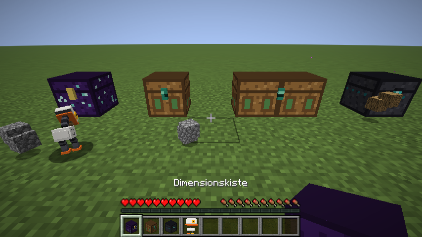

## Inhalt

- [Installation](#installation)
- [Speicher](#speicher): Dimensionskiste und Bibliothek, ME-Speicher, ME-Terminal, ME-Speicher im Browser, Filterkiste, Projektkiste, Trichter und Maschinen
- [Sammelroboter](#sammelroboter): Roboter, Roboter-Station, Rückruf, Roboter-Barriere, Antennen und Fernbedienung
- [ME-Rucksack und Traveler's Backpack](#me-rucksack-und-travelers-backpack)
- [Rezepte](#rezepte)
- [Befehle](#befehle)
- [Einstellungen](#einstellungen)
- [Selbst bauen](#selbst-bauen)

## Installation

`storage-dimension-0.8.0.jar` muss **auf dem Server und bei allen Spielern** im Ordner `mods` liegen.

1. Fabric Loader 0.19.5 oder neuer und [Fabric API](https://modrinth.com/mod/fabric-api) für 26.1.2 auf Server und Clients installieren.
2. `storage-dimension-0.8.0.jar` (nicht die `-sources.jar`) in den `mods`-Ordner legen.
3. Optional das [Traveler's-Backpack-Add-on](#me-rucksack-und-travelers-backpack) `storagedim-tb-0.8.0.jar` dazulegen, ebenfalls auf Server und Clients.
4. Server starten. Die Dimension `storagedim:storage` wird automatisch angelegt, die Daten liegen in `world/storagedim.json`.

**Passt gut dazu (optional):** [JEI](https://modrinth.com/mod/jei) (Rezepte, Suche koppeln, „+“ im Rucksack), [Jade](https://modrinth.com/mod/jade) (Infos zu Robotern und Stationen), [Xaero's Minimap](https://modrinth.com/mod/xaeros-minimap) (Roboter auf der Karte). Getestet mit JEI 29.47.0.111, Jade 26.1.11 und Xaero's Minimap 26.6.2.

### Als Modrinth-Pack

`storage-dimension.mrpack` liegt in jedem [Release](https://github.com/Nomisimo/Storage-Dimension/releases). Es enthält Fabric API (wird von Modrinth geladen) und die Storage-Dimension-Jar, Minecraft 26.1.2 und Fabric Loader 0.19.5 sind festgelegt. Spieler können dasselbe Pack in der Modrinth-App installieren.

- **Server-Hoster mit Modpack-Upload:** Neuen Server mit „Modpack hochladen / .mrpack“ anlegen und die Datei auswählen.
- **Eigener Server:** Mit [mrpack-install](https://github.com/nothub/mrpack-install): `mrpack-install storage-dimension.mrpack --server-dir server`. Das lädt den Fabric-Server und Fabric API und legt die Mod ab.

## Speicher

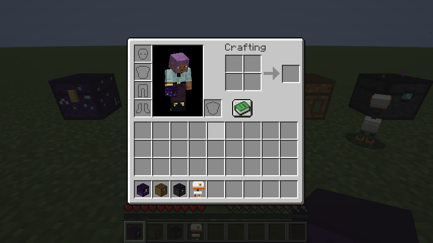

### Dimensionskiste und Bibliothek

- Eine violette Kiste mit Endsternen. Wer sie öffnet und Zugriff auf den Speicher hat, landet in der Eingangshalle der Bibliothek in der Storage Dimension. Beliebig viele Spieler können gleichzeitig dort sein.
- Wer keinen Zugriff hat, sieht nur ein leeres Kisten-Inventar, in dem nichts gelagert werden kann.
- **Aufbau:** Von der Halle gehen lange Gänge im Stil einer alten Bibliothek ab: Bücherregale als Wände, dunkles Eichenholz, ein roter Läufer und Laternen an Säulen. Jeder Gang ist eine Abteilung, über dem Eingang steht ihr Name und wie viele Sorten sie hat: Stein, Holz, Natur, Erze & Metalle, Essen, Mob-Drops, Redstone, Werkzeuge & Waffen, Rüstung, Tränke & Magie, Farben & Deko und Sonstiges. Items anderer Mods werden nach ihrem Namen einsortiert. Durch ein Glasfenster in der Decke der Halle sieht man am End-Himmel den Kisten-Mond: flach wie die Sonne in der Oberwelt, mit der Kistenfront immer zum Spieler.
- **Kisten mit echten Stapeln:** In den Regalen stehen normale Kisten, drei übereinander. Jede Kiste hat 27 Plätze mit normalen Stapeln (64, oder so viel, wie das Item stapelt), eine Sorte bekommt also so viele Kisten, wie sie braucht (höchstens 64 pro Sorte; was darüber hinausgeht, ist weiter im ME-Speicher und im ME-Terminal). Innerhalb eines Gangs sind die Sorten nach Mod und Name sortiert, vor jeder Kiste schwebt ihr Item.
- Was man herausnimmt, ist auch aus dem ME-Speicher weg; Shift-Klick aus dem eigenen Inventar lagert ein (auch wenn die Kiste voll ist). Eine Kiste nimmt nur ihre Sorte an. Die Kisten einer Sorte sind immer von vorne gefüllt, die letzte Kiste einer Sorte leert sich zuerst. Werkzeuge und andere Items mit Haltbarkeit teilen sich die Kisten pro Item, verzauberte Bücher, Tränke usw. bekommen je Variante eigene.
- **Katalog und Teleport:** Rechtsklick auf das Lesepult in der Halle oder am Ende jedes Gangs öffnet den Katalog. Ein Klick auf eine Abteilung teleportiert an den Anfang ihres Gangs. **Item suchen** teleportiert direkt vor die erste Kiste eines Items (sucht auch nach Trank-Wirkung und Verzauberung). Außerdem gibt es dort Knöpfe zurück in die Halle und zum Verlassen.
- Die Bibliothek wächst mit: Neue Sorten bekommen sofort Kisten am Ende ihres Gangs. Leere Kisten verschwinden und die Kistenzahl wird angepasst, wenn gerade niemand in der Bibliothek ist; beim nächsten Betreten wird neu sortiert.
- **Drachenei-Altar:** Liegt ein Drachenei im ME-Speicher, steht mitten in der Eingangshalle ein Altar, über dem das Ei schwebt. Ist das Ei wieder draußen, verschwindet der Altar.
- **Handelshalle:** Dorfbewohner, die im Eimer im ME-Speicher liegen (z. B. mit [Villager In A Bucket](https://modrinth.com/mod/villager-in-a-bucket)), leben in einer Handelshalle hinter der Südwand der Eingangshalle. Der Eingang ist ein Zauntor rechts neben dem roten Läufer: Du kannst es öffnen, die Dorfbewohner nicht. Jeder hat einen offenen Stand mit seinem Arbeitsblock, darüber hängt ein Holzschild mit seinem wertvollsten Handel. Die Stände sind nach Beruf sortiert, innerhalb eines Berufs die mit der höchsten Stufe (Meister) vorne an der Tür. Hinten liegt ein Dorfplatz mit Glocke und Bänken. Die Dorfbewohner laufen herum, arbeiten an ihren Arbeitsblöcken, treffen sich am Platz und tratschen wie im Dorf. **Markt:** Stellst du dich an einen Arbeitsblock, kommen alle Dorfbewohner dieses Berufs zu dir, die besten zuerst und am nächsten. Man kann mit ihnen handeln, sie füllen ihre Angebote regelmäßig auf. Schlagen, mit dem Eimer einfangen, anleinen oder umbenennen geht nicht. Arbeitslose stehen still, damit sie keinem anderen den Arbeitsblock wegnehmen; Babys und Dorfbewohner, die nicht aus einem Eimer kommen, verschwinden (sonst wären es Kopien). Die Halle gibt es nur, solange Dorfbewohner im ME-Speicher liegen (höchstens 64 leben dort). Was ein Dorfbewohner in der Halle dazulernt, bleibt nur, solange sein Eimer im ME-Speicher liegt; der Eimer selbst ändert sich nicht.
- In der Bibliothek lässt sich nichts abbauen oder hinstellen.
- Raus geht es per Rechtsklick auf den Leuchtstein in der Halle, über den Katalog oder mit `/storage raus`.
- Standardmäßig teilen sich alle Spieler einen Speicher und eine Bibliothek. Mit `sharedStorage = false` bekommt jeder Speicher seine eigene (siehe [Einstellungen](#einstellungen)).
- Welten aus Version 0.7 und älter: Die alte Kisten-Insel wird beim ersten Betreten abgebaut und durch die Bibliothek ersetzt. Die Items selbst liegen im ME-Speicher und bleiben, wie sie sind.

### ME-Speicher

Alle Items liegen ohne Stapel- oder Slot-Grenzen im ME-Speicher. Die genaue Menge steht im Namen jedes Items (z. B. „Bruchstein × 1.234“) und in kleiner Schrift auf dem Symbol, ab 1.000 abgekürzt (1k, 1.2k, 45k, 1.2M …).

- Linksklick nimmt einen Stapel, Rechtsklick ein einzelnes Item. Shift-Linksklick füllt das ganze Inventar (ohne Hotbar) mit dem Item, Shift-Rechtsklick das halbe. Ist weniger im Speicher, kommt alles, was da ist.
- Ein Item auf dem Cursor ins Fenster klicken oder Shift-Klick im eigenen Inventar lagert ein.
- **Oben:** Suchfeld (sucht beim Tippen, ist beim nächsten Öffnen wieder leer; findet auch Tränke nach Wirkung und verzauberte Items und Bücher nach Verzauberung, z. B. „healing“ oder „sharpness“) und Sortier-Knopf *Menge* / *A–Z* (bleibt gespeichert). Mit JEI sitzt dazwischen der Schalter **J**: Ist er grün, sind die Suche und die JEI-Suchleiste gekoppelt.
- **Unten:** **◀ / ▶** blättern seitenweise, das Mausrad scrollt zeilenweise durch alle Items. **Einlagern** lagert das ganze Inventar ohne Hotbar ein, daneben stehen Seite, Sorten und Gesamtmenge.
- Ohne die Mod auf dem Client gibt es statt der Knöpfe Item-Symbole (Pfeile, Trichter, Komparator).

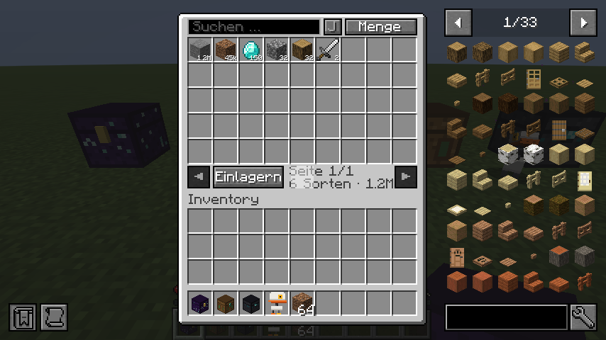

### ME-Terminal

Eine uralte Kiste aus Tiefenschiefer mit Sculk-Rune. Hingestellt öffnet sie per Rechtsklick direkt den ME-Speicher, ohne Dimensionswechsel.

### ME-Speicher im Browser

Der Server zeigt den ME-Speicher und die Projekte auch als Webseite, z. B. auf dem Handy neben dem Spiel.

- `/storage web` schickt dir einen anklickbaren Link (`http://<adresse>:8765/#…`). Die Seite aktualisiert sich alle 10 Sekunden.
- **ME-Speicher:** alle Items mit Bild, Menge, Abteilung, Verzauberungen und Trank-Wirkung, mit Suche, Sortierung nach Menge oder A–Z und Filter nach Abteilung. Herausnehmen oder einlagern geht dort nicht.
- **Projekte:** zeigt alle Projekte deines Speichers mit Fortschritt, was da ist und was fehlt. Du kannst dort neue Projekte anlegen, umbenennen, „Im ME blocken“ umschalten, Items über die Suche hinzufügen (Items im Speicher zuerst, dann alle Items des Spiels samt jedem Trank und Verzauberungsbuch), Mengen ändern und Items entfernen. Ein neues Projekt steht auch gleich in der Eingangshalle der Bibliothek.
- Jeder Spieler sieht den Speicher, den er auch im Spiel benutzt. Der Link ist geheim: Wer ihn hat, sieht deinen Speicher und kann deine Projekte ändern. `/storage web neu` macht einen neuen Link, der alte geht dann nicht mehr. Die Links liegen in `world/storagedim-web.json`.
- **Für den Server:** Der Port (`webPort`, Standard 8765) muss von außen erreichbar sein, bei einem Hoster also als zusätzlicher Port freigegeben. In `webAddress` gehört die Adresse, unter der die Spieler den Server erreichen (ohne Port), sonst steht im Link `localhost`. Mit `webPort = 0` ist die Webseite aus.
- Bilder von Minecraft-Items kommen aus einer öffentlichen Kopie der Spieltexturen (jsDelivr bzw. GitHub), die der Mod liefert der Server selbst. Ohne Internet oder bei Items anderer Mods steht statt des Bilds der Anfangsbuchstabe. Item-Namen sind auf Englisch, weil der Server nur die englischen Namen kennt.

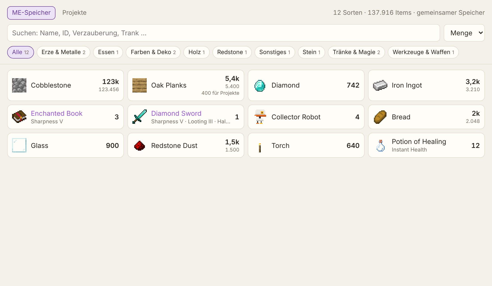
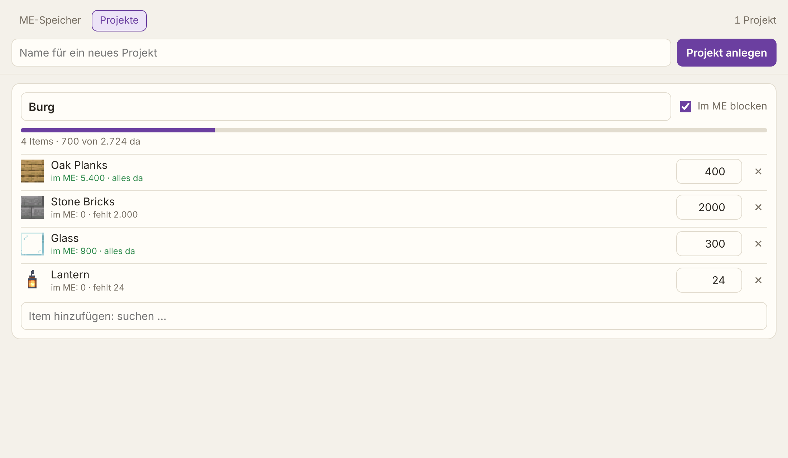

### Filterkiste

Eine Kiste, die nur ausgewählte Items aus dem ME-Speicher zeigt.

- **Filter einstellen:** Schleichen + Rechtsklick mit leerer Hand öffnet die Filter. Ein Item auf einen Platz legen setzt den Filter, Klick mit leerer Hand entfernt ihn. Eine Kiste hat 7 Filter-Plätze.
- **Genaue Filter:** Ist ein Filter-Item verzaubert (auch ein Verzauberungsbuch) oder ein Trank (auch Wurf- und Verweiltrank und Pfeile mit Trank), zählen nur Items mit genau denselben Verzauberungen bzw. demselben Trank. Ein Heiltrank als Filter lässt also nur Heiltränke durch, nicht alle Wurftränke. Das gilt auch für die Filter der Roboter-Station und die Items einer Projektkiste.
- **Benutzen:** Normaler Rechtsklick öffnet die Kiste. Dort lassen sich die gefilterten Items herausnehmen und passende einlagern.
- **Doppelkiste:** Zwei Filterkisten nebeneinander werden eine Doppelkiste mit 14 Filter-Plätzen. Eine normale Kiste verbindet sich nie mit einer Filterkiste. Wird eine Hälfte abgebaut, behält die andere die ersten 7 Filter.
- **Trichter darunter** ziehen die Filter-Items aus dem ME-Speicher heraus. Bis zu ein Stapel pro Filter liegt dafür bereit und geht zurück in den Speicher, wenn ihn keiner abholt.

### Projektkiste

Eine Kiste für ein Bauprojekt: Du legst fest, welche Items in welcher Menge gebraucht werden, und die Kiste zeigt sie aus dem ME-Speicher.

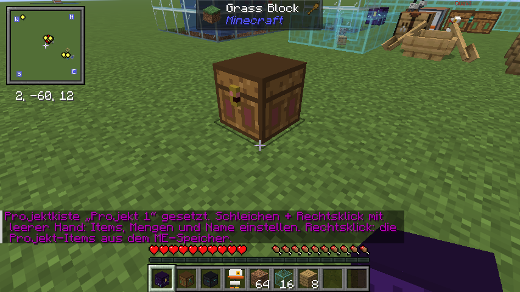

- **Rezept:** Filterkiste + Buch (formlos).
- **Einstellen:** Schleichen + Rechtsklick mit leerer Hand, oder das Zahnrad ⚙ in der Item-Ansicht.
  - Oben: **Name** und der Knopf **Blocken** (Im ME blocken).
  - Die Liste hat eine Zeile pro Item: links das Item, daneben das Mengenfeld mit **-64** und **-1** links und **+1** und **+64** rechts, ganz rechts **✕** zum Entfernen. Die Liste scrollt, unten ist immer eine leere Zeile.
  - Neue Items: in die leere Zeile legen, im eigenen Inventar Shift-klicken, oben im Feld **Item suchen** über alle Items des Spiels suchen und anklicken (auch jeder Trank, Wurftrank, Verweiltrank, Trankpfeil und jedes Verzauberungsbuch in jeder Stufe einzeln), oder ein Item aus der JEI-Liste auf die Liste ziehen. Ein Item mit einem anderen auf dem Cursor anklicken tauscht es aus.
  - Hover über ein Item zeigt, wie viele davon da sind und wie viele fehlen. Ist alles da, wird die Zeile grün.
  - **Rezeptbuch:** Ein Buch mit Feder in den linken Platz legen, rechts kommt es mit dem Projekt beschrieben heraus (Name und eine Zeile pro Item mit Menge).

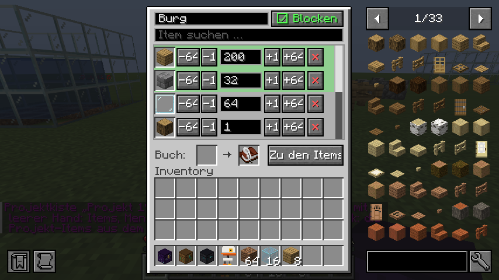
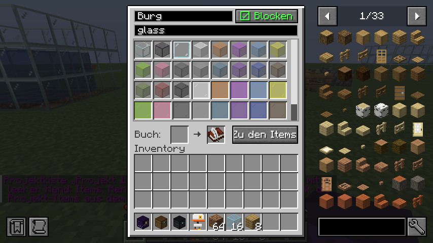

- **Benutzen:** Normaler Rechtsklick zeigt alle Projekt-Items; was nicht im ME-Speicher liegt, steht mit einer roten 0 da. Die Zahlen sind grün, sobald die benötigte Menge da ist, und der Tooltip sagt, wie viele von wie vielen da sind und wie viele fehlen. Baumaterial kann direkt in die Kiste gelegt werden. Das Zahnrad ⚙ neben dem Suchfeld wechselt zu den Einstellungen.
- **Nur die eingestellte Menge:** Aus der Projektkiste lässt sich von jedem Item höchstens die eingestellte Menge herausnehmen. Die Kiste zählt mit, wie viel schon entnommen wurde (Tooltip „Entnommen: 40 von 64“); ist alles draußen, verschwindet das Item aus der Kiste und die Einstellungen zeigen „✔ alles entnommen“. So weißt du, dass du von dem Item alles verbaut hast. Legst du Items zurück in die Projektkiste, zählen sie nicht mehr als entnommen. Entnommenes zählt im Fortschritt als erledigt und wird nicht mehr im ME geblockt.

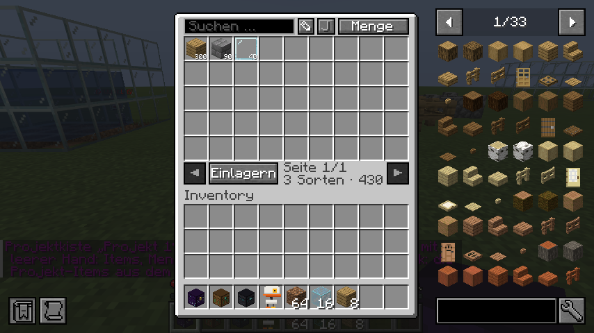
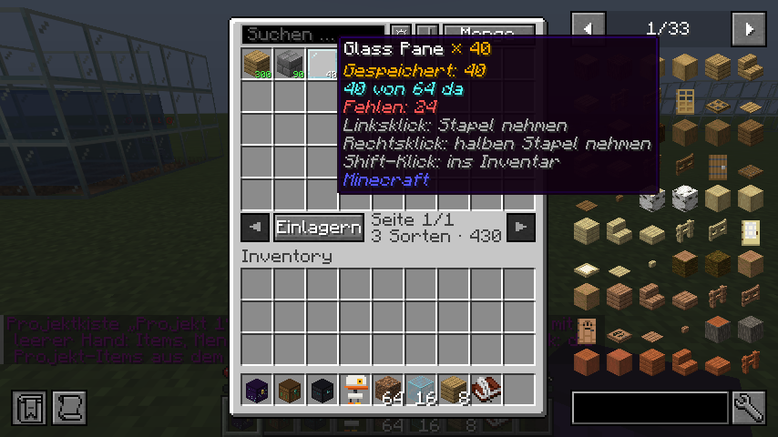

- **Im ME blocken:** Die Mengen des Projekts bleiben für das Projekt im Speicher. Im ME-Terminal, im Rucksack, für Trichter und JEI lässt sich nur herausnehmen, was über das Projekt hinausgeht. Der Tooltip sagt, für welche Projekte wie viel geblockt ist.

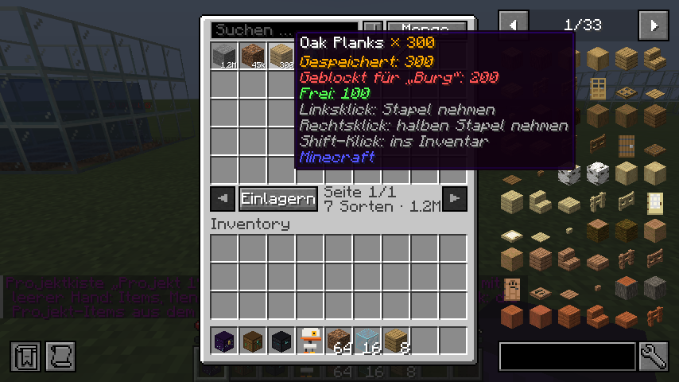

- **In der Bibliothek** stehen die Projektkisten in der Eingangshalle an der Südwand: als Fallenkisten mit dem Projektnamen darüber. Geblockte Items liegen dort nur in der Projektkiste, nicht in den normalen Item-Kisten.


- **Abbauen:** Die Kiste behält ihr Projekt und lässt sich woanders wieder hinstellen.

### Trichter und Maschinen

- Trichter, die in eine Dimensionskiste, Filterkiste oder ein ME-Terminal zeigen, liefern direkt in den Speicher, und zwar alles auf einmal statt ein Item nach dem anderen (ein mit Redstone gesperrter Trichter behält seine Items). Zum Anbauen mit einem Item in der Hand schleichen. Ein Terminal füllt den Speicher dessen, der es hingestellt hat (bei `sharedStorage = false` nehmen Terminals von vor dieser Version nichts an, bis sie neu hingestellt werden).
- Maschinen anderer Mods (z. B. Tech Reborn, Advanced Reborn) sind über die Fabric-Transfer-API angebunden. Was eine Maschine in eine Dimensions- oder Filterkiste oder ein ME-Terminal schiebt, landet im ME-Speicher, und aus einer Filterkiste können Maschinen die Filter-Items herausziehen.

## Sammelroboter

Ein kleiner Roboter mit Schnabel. Er sammelt herumliegende Items ein, immer einen Stapel im Schnabel, und bringt ihn in die Kisten direkt an seiner Station.

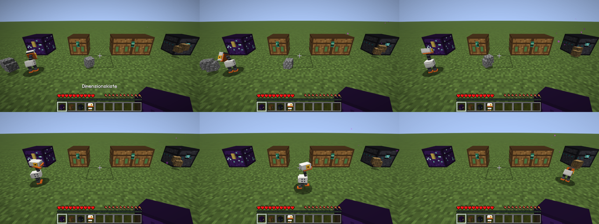

### Roboter-Station

Ohne Station geht nichts: Ein Roboter lässt sich erst hinstellen, wenn er in einer Roboter-Station eingestellt wurde. Jeder Roboter behält dabei seine eigenen Einstellungen (Name, Farbe, Filter, Reichweite), so wie sie beim Einstellen im Item gespeichert wurden. Änderungen an der Station gelten nur für Roboter, die danach eingestellt werden. So können an einer Station Roboter mit ganz verschiedenen Aufgaben arbeiten. Um einen gesetzten Roboter umzustellen, hebt man ihn auf (Schleichen + Rechtsklick) und legt ihn noch einmal in die Station.

Rechtsklick auf die Station öffnet ihr Fenster:

- **Name der Station** ganz oben. Er erscheint auch in Jade und im Tooltip der Roboter.
- **Filter:** bis zu 9 Items (Item draufklicken setzt, leere Hand entfernt). Der Knopf darunter schaltet zwischen *Sammelt nur den Filter* und *Sammelt alles außer Filter*. Leer heißt: alles.
- **Reichweite** mit − und +: 1 bis 10 Chunks, gemessen ab der Station. Mit [Antennen](#antennen-und-fernbedienung) steht hier stattdessen „Antenne verbunden“ und die Größe des Bereichs.
- **Area-Name und Farbe:** Name der Antennen-Area (so steht sie in der Fernbedienung) und ihre Farbe. Klick auf die Farbe schaltet weiter. Ohne Antennen ist es die Farbe der nächsten eingestellten Roboter, mit Antennen tragen alle Roboter der Station sofort die Area-Farbe.
- **Zurückrufen:** siehe unten.
- **Robotername:** für die nächsten Roboter, die eingestellt werden. Bekommen mehrere Roboter einer Station denselben Namen, werden sie durchnummeriert (Quak1, Quak2 …). Das Benennen kostet keine Level.
- **Roboter einstellen:** Roboter links in den Eingang legen, er kommt rechts eingestellt wieder heraus. Genauso werden Antennen mit der Station gepaart. Die Einstellungen stehen im Tooltip des Roboter-Items.
- **Roboterliste** rechts daneben: alle Roboter der Station (höchstens 32) mit Entfernung und dem, was jeder gerade tut. Das Mausrad blättert.

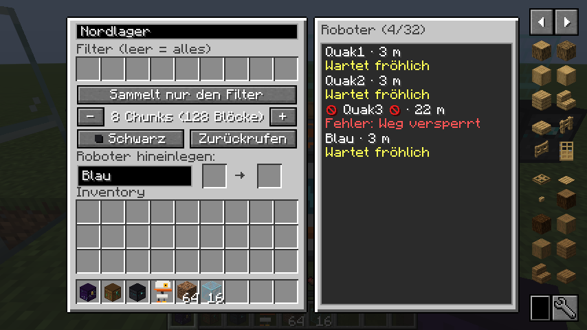

Ein eingestellter Roboter, der außerhalb der Reichweite seiner Station hingestellt wird, läuft zuerst zur Station und arbeitet dann los.

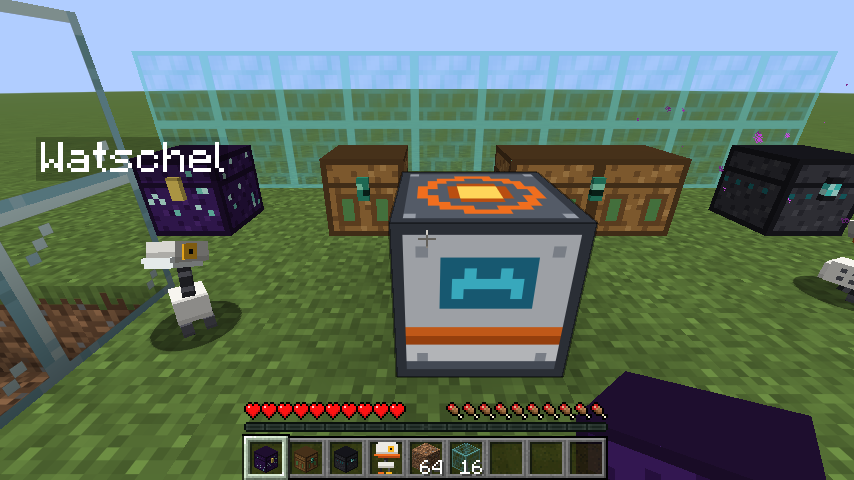

### Wohin die Roboter einlagern

Die Roboter lagern nur in Speicher, der **direkt an der Station** steht, also an einer der sechs Seiten (auch oben und unten). Weiter entfernte Kisten benutzen sie nicht.

- **Erlaubt:** Kisten (auch Fallen- und Kupferkisten), Fässer, Shulkerkisten, Dimensionskisten, Filterkisten, ME-Terminals, Enderkisten und Speicher-Eingänge anderer Mods (Blöcke mit „chest“, „barrel“, „crate“, „drawer“, „storage“, „interface“, „importer“ oder „cabinet“ im Namen, die Items annehmen). Eine normale Enderkiste ist die des Spielers, dem der Roboter gehört, und funktioniert nur, solange dieser online ist.
- **Nie:** Trichter, Spender, Werfer, Öfen, Braustände und andere Maschinen.
- **Reihenfolge:** Passende Filterkisten zuerst, danach die übrigen Kisten in fester Reihenfolge (unten, oben, Norden, Süden, Westen, Osten). So wird eine Kiste nach der anderen voll. Passt nur ein Teil des Stapels, bringt der Roboter den Rest zur nächsten Kiste.
- **Alles voll:** Hat keine Kiste mehr Platz, bringt der Roboter sein Item zurück zur Station, setzt sich traurig hin und zeigt „Fehler: Kisten voll“. Er schaut zweimal pro Sekunde nach. Sobald wieder Platz ist, räumt er ein und arbeitet weiter.
- Mit Datapacks lässt sich die Liste erweitern: Block-Tag `storagedim:robot_storage` (erlaubt) und `storagedim:robot_storage_excluded` (verboten).

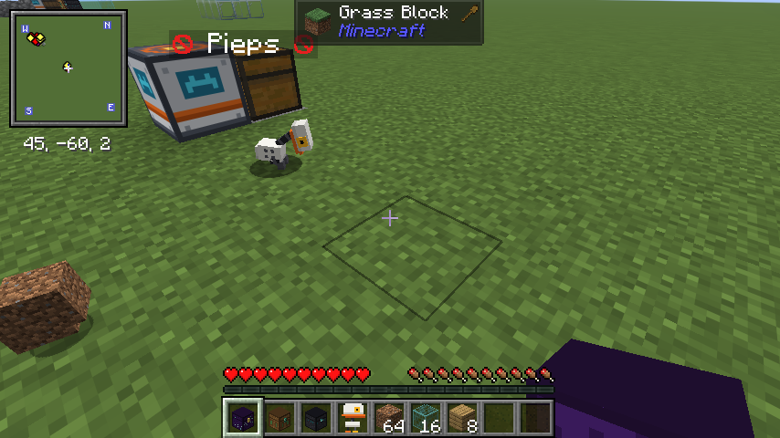

### Zurückrufen

- Alle Roboter der Station laufen sofort los, die Station zeigt „Rückruf: auf dem Weg“.
- Angekommen sind sie im 3×3-Feld um die Station, ab 21 Robotern im 5×5-Feld.
- Teleportiert wird nur, wer keinen Weg zur Station findet. Teleportieren sich mehrere, landet jeder auf einem eigenen freien Platz neben der Station, nie alle auf demselben Block. Wer zu Fuß auf einem schon besetzten Block ankommt, rückt auf einen freien Platz daneben.
- Danach sitzen alle eine Minute an der Station und arbeiten dann normal weiter. Bis dahin schauen sie den Spieler an, der sie gerufen hat.

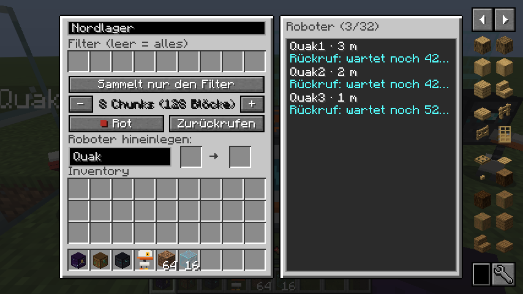

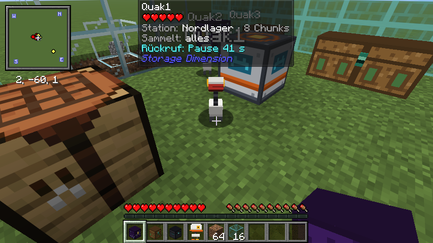

### Wie die Roboter arbeiten

- **Name:** Der Name über dem Kopf, in Jade und in der Stationsliste steht in der Farbe des Roboters (sehr dunkle Farben etwas aufgehellt, damit man sie lesen kann).
- **Einlagern:** Zum Einlagern geht ein Roboter direkt an die Kiste. Der Deckel (bei Fässern die Klappe) geht kurz auf und wieder zu, standardmäßig ohne Geräusch (siehe `robotChestSound` unter [Einstellungen](#einstellungen)). Liegt ein Block auf der Kiste, bleibt der Deckel zu wie bei Spielern; eingelagert wird trotzdem. Eingelagert wird nur, wenn nichts zwischen Roboter und Kiste ist: Er muss frei an der Kiste stehen und kann nicht durch Wände, Böden oder Stufen hindurch einlagern. Schwimmt er unter einer Kiste (zum Beispiel unter Stufen auf dem Wasser), taucht er an einer freien Stelle auf und klettert neben oder auf die Kiste.
- **Schwarm:** Mehrere Roboter stimmen sich ab. Jeder holt ein anderes Item, es rennen nie alle zum selben.
- **Wege:** Bevor ein Roboter losläuft, plant er den ganzen Weg. Gibt es keinen (eingemauert, hinter einer Roboter-Barriere, über Lava), lässt er das Item eine Minute in Ruhe und nimmt das nächste. Bleibt er unterwegs hängen, gibt er nach 5 Sekunden auf. Neu fallengelassene Items bemerkt er nach spätestens einer halben Sekunde.
- **Klettern:** Er hüpft bis zu zwei Blöcke hoch, auch über Zäune und Mauern, und stellt sich zum Aufheben direkt auf das Item. Liegt ein Item in einer Zaunecke, wo er sich nicht draufstellen kann, greift er vom Zaun darüber oder vom Feld daneben zu. Kisten erreicht er bis etwa drei Blöcke über dem Boden. Aus Booten und Loren steigt er sofort wieder aus.
- **Zurück zur Station:** Ohne Arbeit läuft er zu seiner Station. Kommt er dabei 3 Minuten lang nicht näher, teleportiert er sich hin.
- **Warten:** An der Station setzt er sich hin und schaut sich fröhlich um, jeder Roboter in seinem eigenen Takt.
- **Fehler:** Erreicht ein Roboter seine Station nicht, fehlt die Station, steht keine Kiste an der Station oder sind alle Kisten voll, setzt er sich hin, schaut auf den Boden, und links und rechts von seinem Namen steht ein rotes 🚫. Den Grund zeigen Jade und die Stationsliste („Fehler: Weg versperrt“, „Fehler: keine Kiste an der Station“, „Fehler: Kisten voll“, „Fehler: Station fehlt“).
- **Wasser:** Roboter tauchen. Unter Wasser laufen sie am Grund entlang und tragen einen Glashelm um den ganzen Kopf. Im Wasser sind sie so schnell wie an Land, ziehen unter Wasser Blasen und an der Oberfläche Spritzer und eine Bugwelle hinter sich her. Items im Wasser schnappen sie, sobald sie in Reichweite ihres Schnabels sind, auch tief am Grund eines Beckens oder treibend an der Oberfläche (z. B. Seetang): Sie springen vom Rand hinein, tauchen hinunter oder schwimmen hinauf und bringen es danach zur Kiste. Ertrinken können sie nicht.
- **Warteplatz:** Zum Warten setzen sie sich nur auf festen, trockenen Boden, nie ins Wasser. Steht die Station am Wasser, klettern sie zum nächsten trockenen Platz daneben.
- **Regen:** Draußen ohne Dach über sich spannen sie einen kleinen Regenschirm in ihrer Farbe auf.
- **Aufheben:** Schleichen + Rechtsklick mit leerer Hand nimmt einen Roboter wieder auf, samt dem Item im Schnabel.
- Nur Spieler können Robotern schaden. Sie arbeiten nur in geladenen Chunks.

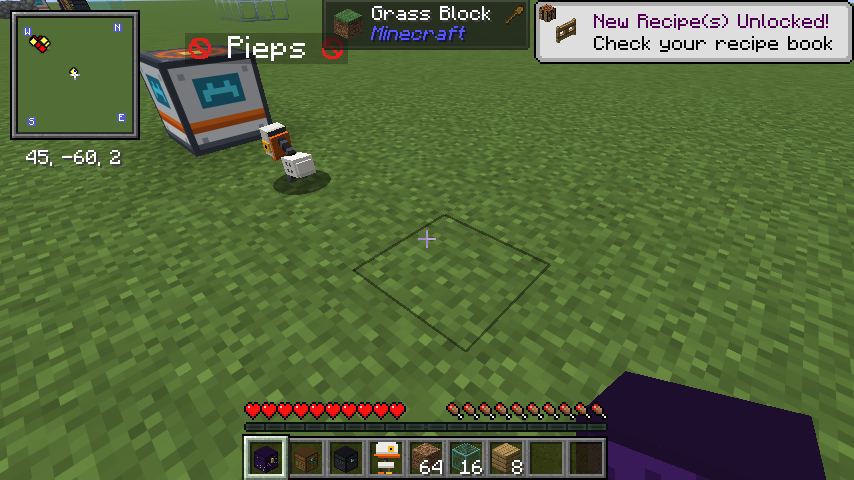

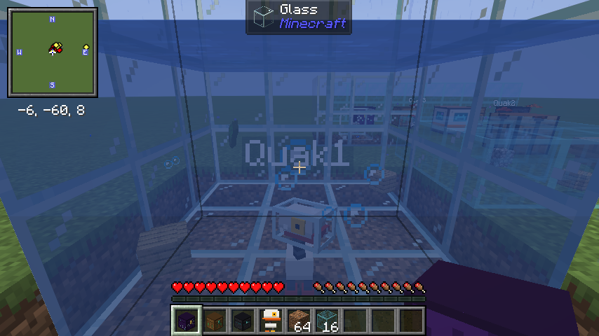

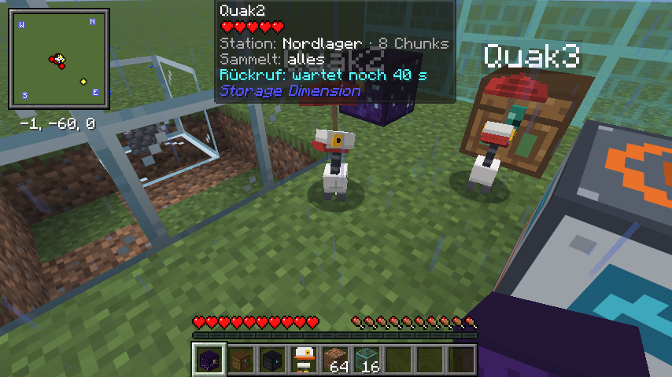

### Jade und Xaero's Minimap

Mit [Jade](https://modrinth.com/mod/jade) zeigt der Blick auf einen Roboter seine Station, Reichweite, Filter und was er gerade tut (oder welchen Fehler er hat). Der Blick auf eine Station zeigt ihren Namen und wie viele Roboter zu ihr gehören. Mit [Xaero's Minimap](https://modrinth.com/mod/xaeros-minimap) erscheinen die Roboter mit ihrem Gesicht auf der Karte.

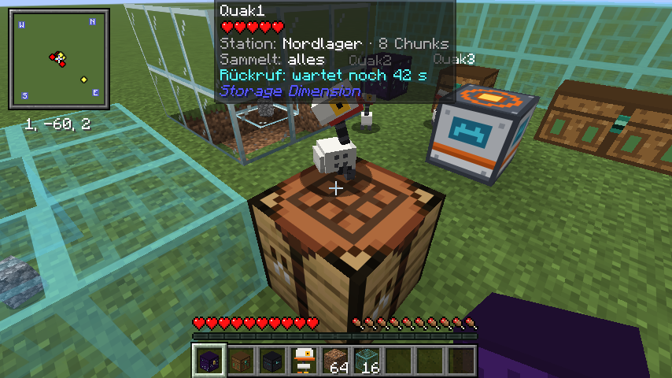

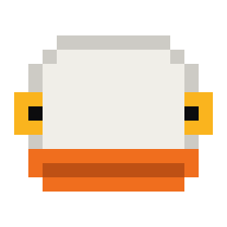

### Roboter-Barriere

Ein durchsichtiger Plasma-Schild. Spieler, Tiere und Items gehen einfach hindurch, Sammelroboter nicht, und sie planen auch keinen Weg hindurch oder darüber. Gut für Türen und Bereiche, aus denen die Roboter nichts holen sollen.

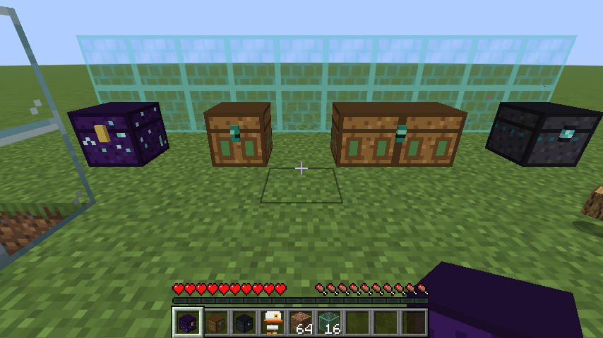

### Antennen und Fernbedienung

Mit zwei Antennen bekommt eine Station statt der Reichweite einen festen Bereich, eine Box, in der ihre Roboter arbeiten.

- **Paaren:** Antenne in den Eingang der Station legen, sie kommt rechts gepaart heraus (wie ein Roboter). Im Tooltip steht, zu welcher Station sie gehört. Ungepaarte Antennen lassen sich nicht setzen.
- **Setzen:** Eine gepaarte Antenne direkt **auf** die Station setzen, die zweite an die gegenüberliegende Ecke. Antennen werden wie End-Ruten gesetzt (sie zeigen von dem Block weg, an den man sie setzt).
- **Der Bereich** ist die Box von der Station bis zur zweiten Antenne, beide eingeschlossen, auch in der Höhe. Station auf 0 0 0 und Antenne auf 4 3 4 gibt also eine Box von 5×4×5 Blöcken. Stehen beide auf derselben Höhe, ist die Box nur einen Block hoch. Höchstens 160 Blöcke in jede Richtung.
- **Für alle Roboter der Station:** Der Bereich gilt sofort für alle ihre Roboter, auch für schon gesetzte, und sie tragen die Area-Farbe. Filter und alles andere bleiben wie eingestellt.
- **Abbauen:** Fehlt eine der beiden Antennen, arbeiten die Roboter wieder mit ihrer Reichweite. Die Station zeigt „Antenne: 1 von 2 gesetzt“. Eine abgebaute Antenne bleibt gepaart und kann gleich wieder gesetzt werden.

**Fernbedienung**

- **In der Hand** (auch in der zweiten Hand) zeigt sie die Areas in der Nähe: dicke Kanten und leicht schimmernde Flächen in der Area-Farbe, darüber der Name. Ausgeschaltete oder pausierte Areas sind grau.
- **Rechtsklick** öffnet ihr Fenster mit allen Areas in der Nähe (bis 256 Blöcke). Mit „An“/„Aus“ wird eine Area geschaltet. Ist sie aus, laufen ihre Roboter zur Station (ein Item im Schnabel bringen sie noch weg), setzen sich hin und warten, bis die Area wieder an ist.
- **Auto-Modus:** Oben im Fenster. Ist er an und trägt ein Spieler die Fernbedienung irgendwo im Inventar, pausieren die Areas, in denen er gerade steht. So laufen einem die Roboter nicht zwischen den Füßen herum. Sobald er draußen ist, arbeiten sie weiter. Eine Fernbedienung im Auto-Modus glitzert.
- **Mehrspieler:** Jeder Spieler mit einer Fernbedienung darf jede Area schalten.

## ME-Rucksack und Traveler's Backpack

Ein Rucksack, der mit dem Speicher verbunden ist und ihn von überall öffnet.

- **Bündel:** ME-Upgrade + Bündel in der Werkbank kombinieren. Rechtsklick öffnet den Speicher.
- **[Traveler's Backpack](https://modrinth.com/mod/travelersbackpack) ohne Add-on:** ME-Upgrade in die Zweithand, den Rucksack in die Haupthand, schleichen und rechtsklicken. Danach öffnet Schleichen + Rechtsklick mit dem Rucksack den ME-Speicher, normaler Rechtsklick weiterhin den Rucksack. Trägst du ihn auf dem Rücken, öffnet `/storage me` den Speicher.

### Traveler's-Backpack-Add-on

Das Add-on `storagedim-tb-0.8.0.jar` fügt ein echtes **ME-Upgrade** für den Upgrade-Slot von Traveler's Backpack hinzu. Es hat immer dieselbe Versionsnummer wie Storage Dimension.

- **Rezept** (formlos): Leeres Upgrade (Traveler's Backpack), Enderauge, 2× Amethystscherbe, Redstoneblock. Mit dem Add-on ergibt auch das normale ME-Upgrade-Rezept (mit Papier) dieses Upgrade. Es passt in den Upgrade-Slot und macht mit einem Bündel auch einen ME-Rucksack.
- **ME-Ansicht:** Upgrade in einen Upgrade-Slot legen. Linksklick auf das ME-Symbol zeigt den ME-Speicher direkt im Rucksack-Fenster an Stelle des Rucksack-Inhalts. Crafting und die anderen Upgrades bleiben daneben. Ein zweiter Linksklick zeigt wieder den Rucksack, Rechtsklick nimmt das Upgrade heraus.
- Der Rucksack öffnet sich so, wie er zuletzt geschlossen wurde: in der ME-Ansicht oder als Rucksack. Die ME-Ansicht ist dabei sofort da, der Rucksack-Inhalt blitzt nicht erst auf. Auch die Sortierung der ME-Ansicht bleibt gespeichert, über Neustarts hinweg (Datei `storagedim-tb.json` im Weltordner).
- **Abschalten:** Wer das nicht will, schaltet in den Mod-Einstellungen (über [Mod Menu](https://modrinth.com/mod/modmenu): Mods → Storage Dimension: Traveler's Backpack → Einstellungen) **ME-Ansicht automatisch öffnen** aus. Dann öffnet sich der Rucksack immer mit seinem eigenen Inhalt. Die Einstellung gilt nur für den eigenen Client und steht in `config/storagedim-tb-client.json` (`"autoOpenMeView": false`), dort lässt sie sich auch ohne Mod Menu ändern.

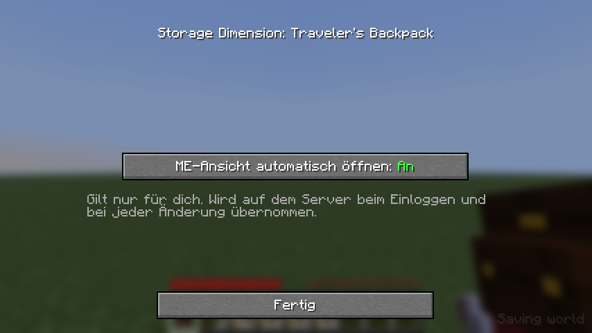

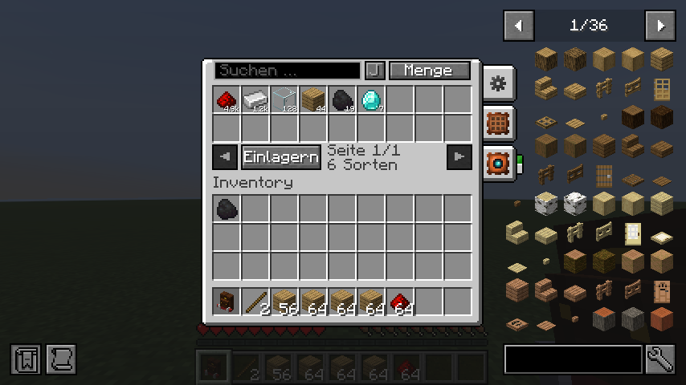

- Die ME-Ansicht ist aufgebaut wie der ME-Speicher: oben eine graue Leiste mit Suchfeld, **J**-Schalter und Sortierung, unten ◀ / ▶, **Einlagern** sowie Seite, Sorten und Gesamtmenge. Das Mausrad scrollt zeilenweise durch alle Items. Die Knöpfe des Rucksacks sind in der ME-Ansicht ausgeblendet.
- Herausnehmen in der ME-Ansicht wie am ME-Terminal: Linksklick nimmt einen Stapel, Rechtsklick ein einzelnes Item, Shift-Linksklick füllt das ganze Inventar (ohne Hotbar) mit dem Item, Shift-Rechtsklick das halbe. Ist weniger im Speicher, kommt alles, was da ist. Ein Item auf dem Cursor ins Fenster klicken lagert es ein.

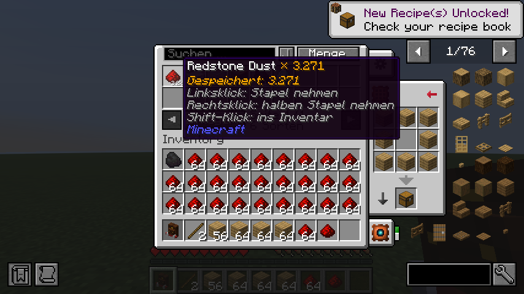

- Der Rucksack muss nicht in der Hand sein: auf dem Rücken tragen und mit der Rucksack-Taste (Standard **B**) öffnen reicht.
- **Crafting aus dem ME-Speicher:** Hat der Rucksack zusätzlich das Crafting-Upgrade, holt der „+“-Knopf von JEI fehlende Zutaten auch aus dem ME-Speicher, genauso wie aus Inventar und Rucksack. „+“ ist nur grün, wenn alle Zutaten zusammen vorhanden sind, sonst markiert JEI die fehlenden rot. Shift + „+“ füllt das Raster für so viele Durchgänge wie möglich (bis zu einem Stapel). Was vorher im Raster lag, kommt zurück ins Inventar oder, wenn das voll ist, in den Speicher.
- Der kleine Schalter neben dem ME-Symbol stellt zwischen *ME als Quelle* (Standard) und *nur Inventar* um.
- **Installation:** `storagedim-tb-0.8.0.jar` und `storage-dimension-0.8.0.jar` auf Server und Clients, dazu Traveler's Backpack, [Forge Config API Port](https://modrinth.com/mod/forge-config-api-port) und Fabric API. JEI wird nur für „+“ und die Rezeptanzeige gebraucht, Mod Menu (optional, nur im Client) für die Einstellungen.

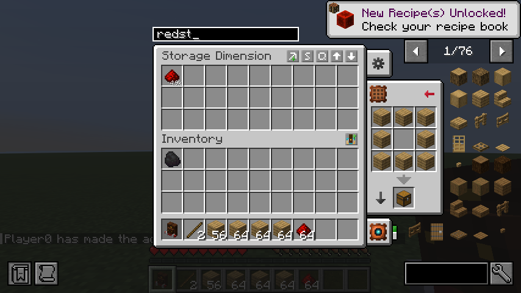

Suche und Sortierung sitzen in der Titelzeile des Fensters, über den Knöpfen des Rucksacks.

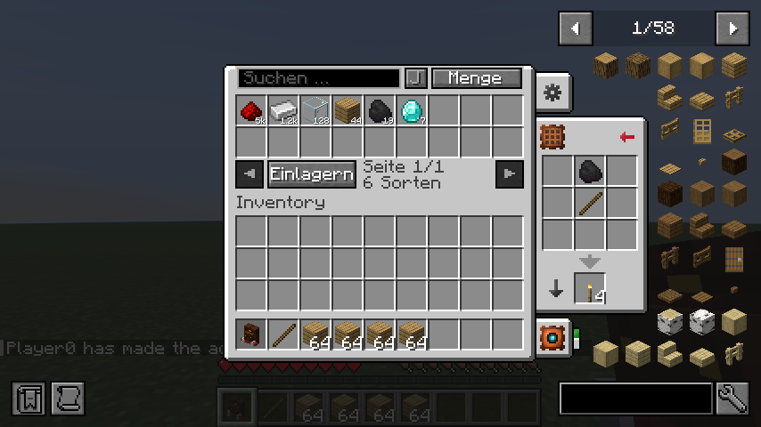

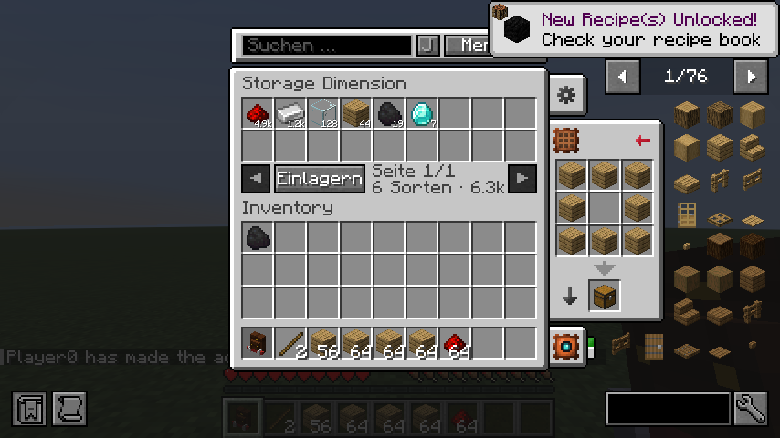

## Rezepte

Alle Rezepte stehen auch in [JEI](https://modrinth.com/mod/jei), auch auf Servern ohne JEI: Storage Dimension schickt die Rezepte selbst an die Spieler. Alle Items der Mod (auch Dimensionskiste, Filterkiste, ME-Terminal & Co.) stehen im eigenen Kreativ-Tab **Storage Dimension** und damit auch in der JEI-Liste: Item suchen, **R** zeigt das Rezept, **U** wofür es gebraucht wird.

| Item | Zutaten | Rezept |
| --- | --- | --- |
| Dimensionskiste | Amethystscherben, Enderperlen, Kiste | 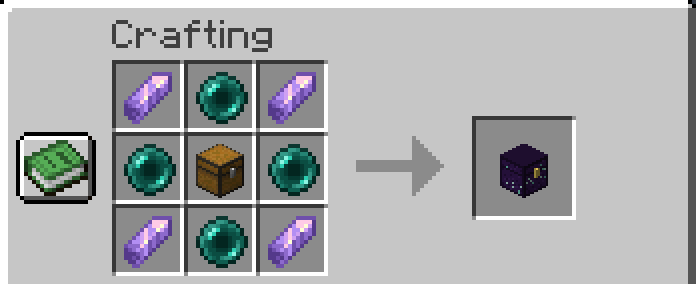 |
| ME-Terminal | Redstone, Amethystscherben, Enderkiste | 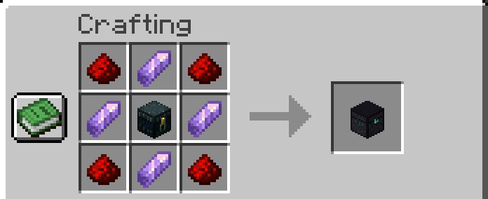 |
| Filterkiste | 8 Rahmen um eine Kiste, unten mittig ein Enderauge | 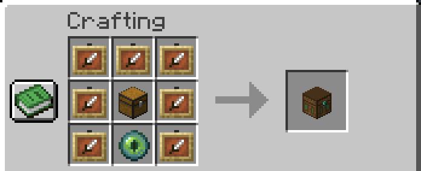 |
| Projektkiste | formlos: Filterkiste + Buch | 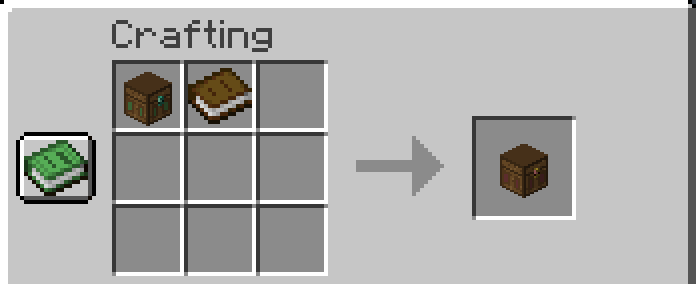 |
| Sammelroboter | Eisenbarren, Kürbis, Redstone, Trichter, Eisennuggets | 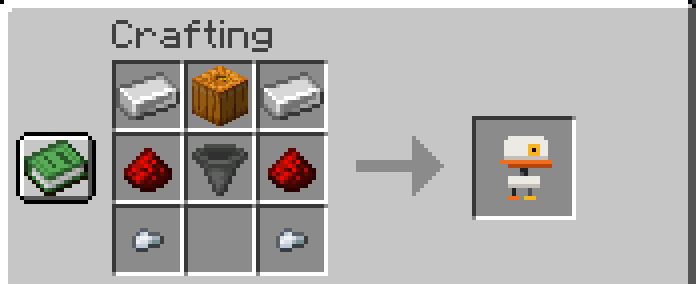 |
| Roboter-Station | Blitzableiter, Eisenbarren, Redstoneblock, Kiste | 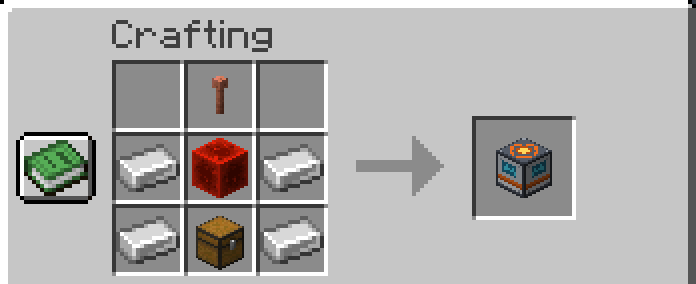 |
| Roboter-Barriere (8 Stück) | 8 Glas um eine Amethystscherbe | 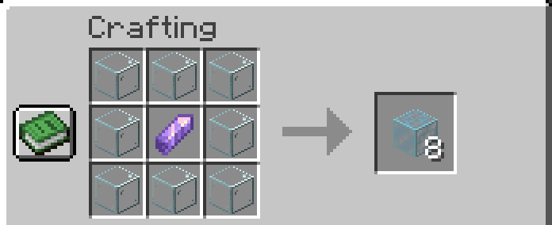 |
| Antenne | formlos: Blitzableiter, 2× Kupferbarren, Redstone | 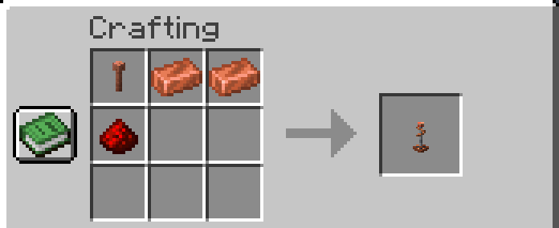 |
| Fernbedienung | Redstone oben mittig, Glasscheibe in der Mitte, Enderperle unten mittig, 4 Kupferbarren links und rechts davon | 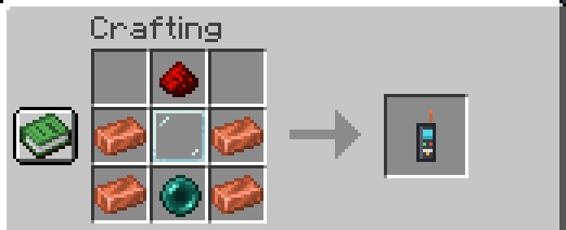 |
| ME-Upgrade | formlos: Enderauge, 2× Amethystscherbe, Redstoneblock, Papier | 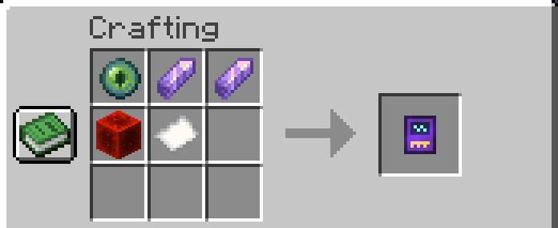 |
| ME-Rucksack | formlos: beliebiges Bündel + ME-Upgrade | 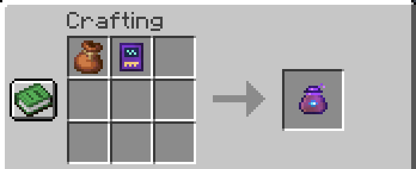 |
| ME-Upgrade (Add-on) | formlos: Leeres Upgrade, Enderauge, 2× Amethystscherbe, Redstoneblock (mit dem Add-on geht auch das Papier-Rezept oben) | 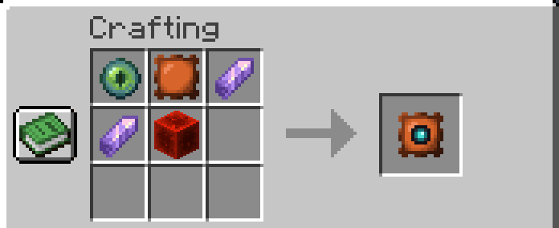 |

## Befehle

| Befehl | Wirkung |
| --- | --- |
| `/storage` | Infos zum eigenen Speicher |
| `/storage raus` | Verlässt die Bibliothek |
| `/storage web` | Link zum ME-Speicher im Browser ([mehr](#me-speicher-im-browser)) |
| `/storage web neu` | Neuer Link, der alte geht dann nicht mehr |
| `/storage me` | Öffnet den ME-Speicher, wenn du einen ME-Rucksack trägst oder dabeihast |
| `/storage teilen <spieler>` | Lädt jemanden in deinen Speicher ein (nur ohne gemeinsamen Speicher) |
| `/storage annehmen` | Nimmt eine Einladung an. Dein eigener Speicher bleibt erhalten. |
| `/storage verlassen` | Zurück zum eigenen Speicher |
| `/storage entfernen <spieler>` | Wirft ein Mitglied raus |
| `/storage kiste besitzer <spieler>` | Danach eine eigene Dimensionskiste anklicken, um sie jemandem zu übertragen |
| `/storage give [spieler]` | (OP) Gibt eine Dimensionskiste |
| `/storage give terminal` | (OP) Gibt ein ME-Terminal |
| `/storage give filter` | (OP) Gibt eine Filterkiste |
| `/storage give projekt` | (OP) Gibt eine Projektkiste |
| `/storage give robot` | (OP) Gibt einen Sammelroboter |
| `/storage give station` | (OP) Gibt eine Roboter-Station |
| `/storage give barrier` | (OP) Gibt 16 Roboter-Barrieren |
| `/storage give antenne` | (OP) Gibt 2 Antennen |
| `/storage give fernbedienung` | (OP) Gibt eine Fernbedienung |

## Einstellungen

In `config/storagedim.json`:

| Einstellung | Standard | Wirkung |
| --- | --- | --- |
| `sharedStorage` | `true` | Alle Spieler teilen sich einen Speicher und eine Bibliothek. Mit `false` bekommt jeder seinen eigenen, der sich per `/storage teilen` freigeben lässt (auf dem Server). |
| `robotChestSound` | `false` | Geht eine Kiste beim Einlagern durch einen Roboter auf, ist sie standardmäßig still (nur der Deckel bewegt sich). Mit `true` macht sie dabei das Öffnen- und Schließen-Geräusch (auf dem Server). |
| `webPort` | `8765` | Port der [Webansicht](#me-speicher-im-browser) (auf dem Server). `0` schaltet sie aus. |
| `webAddress` | `""` | Adresse des Servers für den Link von `/storage web`, z. B. `mc.example.de` (ohne Port). Leer: `localhost`. |
| `jeiSearchSync` | `false` | Schalter **J**: Suche im ME-Speicher mit der JEI-Suchleiste koppeln (beim Spieler, lässt sich im Fenster umschalten). |

## Selbst bauen

Java 25 wird benötigt.

```
cd storage-dimension
./gradlew build
```

Die fertige Datei liegt in `storage-dimension/build/libs/`. GitHub Actions baut bei jedem Push automatisch, macht Test-Screenshots im echten Spiel und legt die Jars auf den Branch `builds`. Ein Release entsteht per Hand unter *Actions → Release → Run workflow*.
