# Storage Dimension

Ein Fabric-Mod für **Minecraft 26.1.2**: ein gemeinsamer Lagerraum in einer eigenen Dimension, ein ME-Speicher ohne Stapelgrenzen und kleine Sammelroboter, die herumliegende Items einsammeln und einlagern.

**Aktuelle Version: 0.5.0.** Die fertigen Dateien gibt es unter [Releases](https://github.com/Nomisimo/Storage-Dimension/releases), dort steht auch, welche Datei wohin gehört.

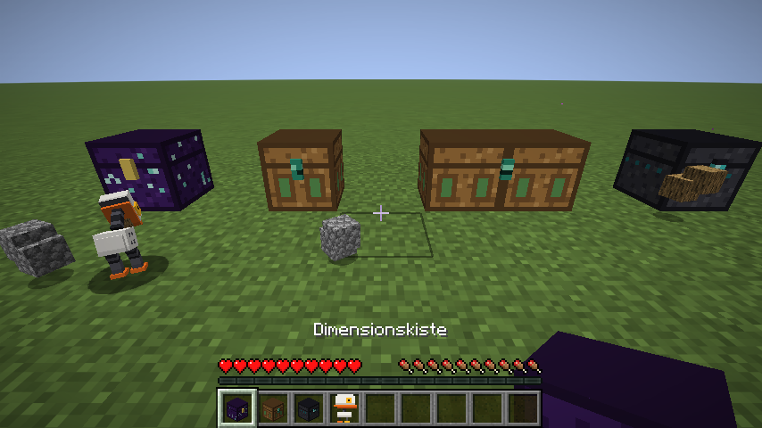

## Inhalt

- [Installation](#installation)
- [Speicher](#speicher): Dimensionskiste, ME-Speicher, ME-Terminal, Filterkiste, Trichter und Maschinen
- [Sammelroboter](#sammelroboter): Roboter, Roboter-Station, Rückruf, Roboter-Barriere
- [ME-Rucksack und Traveler's Backpack](#me-rucksack-und-travelers-backpack)
- [Rezepte](#rezepte)
- [Befehle](#befehle)
- [Einstellungen](#einstellungen)
- [Selbst bauen](#selbst-bauen)

## Installation

`storage-dimension-0.5.0.jar` muss **auf dem Server und bei allen Spielern** im Ordner `mods` liegen.

1. Fabric Loader 0.19.5 oder neuer und [Fabric API](https://modrinth.com/mod/fabric-api) für 26.1.2 auf Server und Clients installieren.
2. `storage-dimension-0.5.0.jar` (nicht die `-sources.jar`) in den `mods`-Ordner legen.
3. Optional das [Traveler's-Backpack-Add-on](#me-rucksack-und-travelers-backpack) `storagedim-tb-0.5.0.jar` dazulegen, ebenfalls auf Server und Clients.
4. Server starten. Die Dimension `storagedim:storage` wird automatisch angelegt, die Daten liegen in `world/storagedim.json`.

**Passt gut dazu (optional):** [JEI](https://modrinth.com/mod/jei) (Rezepte, Suche koppeln, „+“ im Rucksack), [Jade](https://modrinth.com/mod/jade) (Infos zu Robotern und Stationen), [Xaero's Minimap](https://modrinth.com/mod/xaeros-minimap) (Roboter auf der Karte). Getestet mit JEI 29.47.0.111, Jade 26.1.11 und Xaero's Minimap 26.6.2.

### Als Modrinth-Pack

`storage-dimension.mrpack` liegt in jedem [Release](https://github.com/Nomisimo/Storage-Dimension/releases). Es enthält Fabric API (wird von Modrinth geladen) und die Storage-Dimension-Jar, Minecraft 26.1.2 und Fabric Loader 0.19.5 sind festgelegt. Spieler können dasselbe Pack in der Modrinth-App installieren.

- **Server-Hoster mit Modpack-Upload:** Neuen Server mit „Modpack hochladen / .mrpack“ anlegen und die Datei auswählen.
- **Eigener Server:** Mit [mrpack-install](https://github.com/nothub/mrpack-install): `mrpack-install storage-dimension.mrpack --server-dir server`. Das lädt den Fabric-Server und Fabric API und legt die Mod ab.

## Speicher

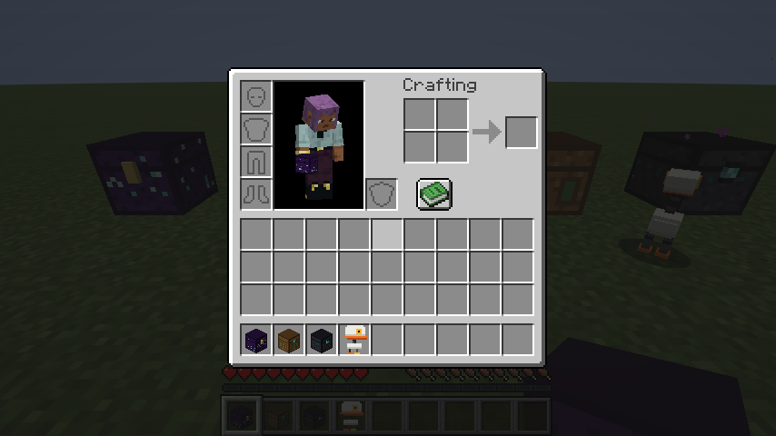

### Dimensionskiste und Lagerraum

- Eine violette Kiste mit Endsternen. Wer sie öffnet und Zugriff auf den Speicher hat, wird in den Lagerraum in der Storage Dimension gezogen. Beliebig viele Spieler können gleichzeitig drin sein.
- Wer keinen Zugriff hat, sieht nur ein leeres Kisten-Inventar, in dem nichts gelagert werden kann.
- Im Raum stehen das ME-Terminal (die Enderkiste), eine Werkbank und ein Ofen. Gecraftet wird direkt in der Dimension.
- Raus geht es per Rechtsklick auf den Leuchtstein im Raum oder mit `/storage raus`.
- Standardmäßig teilen sich alle Spieler einen Speicher und einen Raum (siehe [Einstellungen](#einstellungen)).

### ME-Speicher

Alle Items liegen ohne Stapel- oder Slot-Grenzen im ME-Speicher. Die genaue Menge steht im Namen jedes Items (z. B. „Bruchstein × 1.234“) und in kleiner Schrift auf dem Symbol, ab 1.000 abgekürzt (1k, 1.2k, 45k, 1.2M …).

- Linksklick nimmt einen Stapel, Rechtsklick einen halben, Shift-Klick schiebt ihn ins Inventar.
- Ein Item auf dem Cursor ins Fenster klicken oder Shift-Klick im eigenen Inventar lagert ein.
- **Oben:** Suchfeld (sucht beim Tippen, ist beim nächsten Öffnen wieder leer) und Sortier-Knopf *Menge* / *A–Z* (bleibt gespeichert). Mit JEI sitzt dazwischen der Schalter **J**: Ist er grün, sind die Suche und die JEI-Suchleiste gekoppelt.
- **Unten:** **◀ / ▶** blättern, **Einlagern** lagert das ganze Inventar ohne Hotbar ein, daneben stehen Seite, Sorten und Gesamtmenge.
- Ohne die Mod auf dem Client gibt es statt der Knöpfe Item-Symbole (Pfeile, Trichter, Komparator).

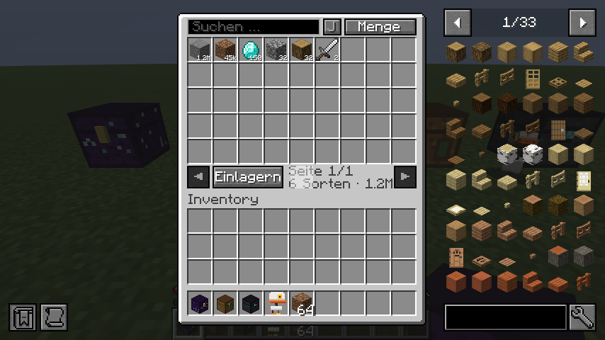

### ME-Terminal

Eine uralte Kiste aus Tiefenschiefer mit Sculk-Rune. Hingestellt öffnet sie per Rechtsklick direkt den ME-Speicher, ohne Dimensionswechsel.

### Filterkiste

Eine Kiste, die nur ausgewählte Items aus dem ME-Speicher zeigt.

- **Filter einstellen:** Schleichen + Rechtsklick mit leerer Hand öffnet die Filter. Ein Item auf einen Platz legen setzt den Filter, Klick mit leerer Hand entfernt ihn. Eine Kiste hat 7 Filter-Plätze.
- **Verzauberte Filter:** Ist ein Filter-Item verzaubert (auch ein Verzauberungsbuch), zählen nur Items mit genau denselben Verzauberungen.
- **Benutzen:** Normaler Rechtsklick öffnet die Kiste. Dort lassen sich die gefilterten Items herausnehmen und passende einlagern.
- **Doppelkiste:** Zwei Filterkisten nebeneinander werden eine Doppelkiste mit 14 Filter-Plätzen. Eine normale Kiste verbindet sich nie mit einer Filterkiste. Wird eine Hälfte abgebaut, behält die andere die ersten 7 Filter.
- **Trichter darunter** ziehen die Filter-Items aus dem ME-Speicher heraus. Bis zu ein Stapel pro Filter liegt dafür bereit und geht zurück in den Speicher, wenn ihn keiner abholt.

### Trichter und Maschinen

- Trichter, die in eine Dimensionskiste oder Filterkiste zeigen, liefern direkt in den Speicher. Zum Anbauen mit einem Item in der Hand schleichen.
- Maschinen anderer Mods (z. B. Tech Reborn, Advanced Reborn) sind über die Fabric-Transfer-API angebunden. Was eine Maschine in eine Dimensions- oder Filterkiste schiebt, landet im ME-Speicher, und aus einer Filterkiste können Maschinen die Filter-Items herausziehen.

## Sammelroboter

Ein kleiner Roboter mit Schnabel. Er sammelt herumliegende Items ein, immer einen Stapel im Schnabel, und bringt ihn in die Kisten direkt an seiner Station.

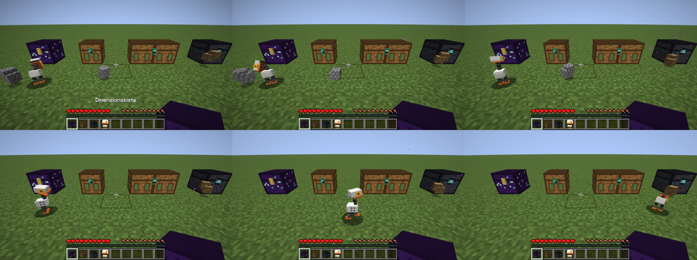

### Roboter-Station

Ohne Station geht nichts: Ein Roboter lässt sich erst hinstellen, wenn er in einer Roboter-Station eingestellt wurde. Jeder Roboter behält dabei seine eigenen Einstellungen (Name, Farbe, Filter, Reichweite), so wie sie beim Einstellen im Item gespeichert wurden. Änderungen an der Station gelten nur für Roboter, die danach eingestellt werden. So können an einer Station Roboter mit ganz verschiedenen Aufgaben arbeiten. Um einen gesetzten Roboter umzustellen, hebt man ihn auf (Schleichen + Rechtsklick) und legt ihn noch einmal in die Station.

Rechtsklick auf die Station öffnet ihr Fenster:

- **Name der Station** ganz oben. Er erscheint auch in Jade und im Tooltip der Roboter.
- **Filter:** bis zu 9 Items (Item draufklicken setzt, leere Hand entfernt). Der Knopf darunter schaltet zwischen *Sammelt nur den Filter* und *Sammelt alles außer Filter*. Leer heißt: alles.
- **Reichweite** mit − und +: 1 bis 10 Chunks, gemessen ab der Station.
- **Farbe:** Klick schaltet weiter.
- **Zurückrufen:** siehe unten.
- **Robotername:** für die nächsten Roboter, die eingestellt werden. Bekommen mehrere Roboter einer Station denselben Namen, werden sie durchnummeriert (Quak1, Quak2 …). Das Benennen kostet keine Level.
- **Roboter einstellen:** Roboter links in den Eingang legen, er kommt rechts eingestellt wieder heraus. Die Einstellungen stehen im Tooltip des Roboter-Items.
- **Roboterliste** rechts daneben: alle Roboter der Station (höchstens 32) mit Entfernung und dem, was jeder gerade tut. Das Mausrad blättert.

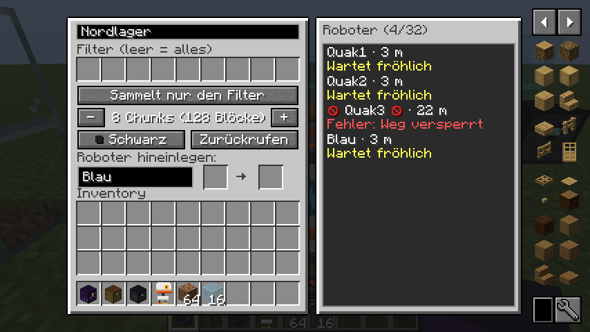

Ein eingestellter Roboter, der außerhalb der Reichweite seiner Station hingestellt wird, läuft zuerst zur Station und arbeitet dann los.

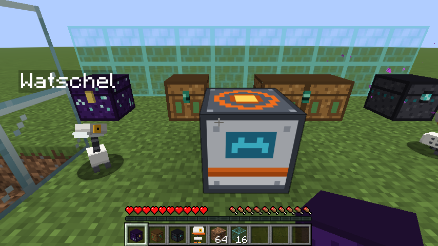

### Wohin die Roboter einlagern

Die Roboter lagern nur in Speicher, der **direkt an der Station** steht, also an einer der sechs Seiten (auch oben und unten). Weiter entfernte Kisten benutzen sie nicht.

- **Erlaubt:** Kisten (auch Fallen- und Kupferkisten), Fässer, Shulkerkisten, Dimensionskisten, Filterkisten, ME-Terminals, Enderkisten und Speicher-Eingänge anderer Mods (Blöcke mit „chest“, „barrel“, „crate“, „drawer“, „storage“, „interface“, „importer“ oder „cabinet“ im Namen, die Items annehmen). Eine normale Enderkiste ist die des Spielers, dem der Roboter gehört, und funktioniert nur, solange dieser online ist.
- **Nie:** Trichter, Spender, Werfer, Öfen, Braustände und andere Maschinen.
- **Reihenfolge:** Passende Filterkisten zuerst, danach die übrigen Kisten in fester Reihenfolge (unten, oben, Norden, Süden, Westen, Osten). So wird eine Kiste nach der anderen voll. Passt nur ein Teil des Stapels, bringt der Roboter den Rest zur nächsten Kiste.
- **Alles voll:** Hat keine Kiste mehr Platz, bringt der Roboter sein Item zurück zur Station, setzt sich traurig hin und zeigt „Fehler: Kisten voll“. Er schaut zweimal pro Sekunde nach. Sobald wieder Platz ist, räumt er ein und arbeitet weiter.
- Mit Datapacks lässt sich die Liste erweitern: Block-Tag `storagedim:robot_storage` (erlaubt) und `storagedim:robot_storage_excluded` (verboten).

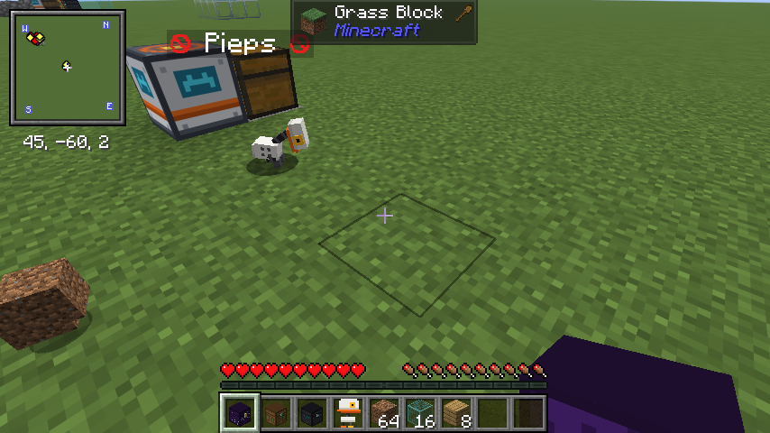

### Zurückrufen

- Alle Roboter der Station laufen sofort los, die Station zeigt „Rückruf: auf dem Weg“.
- Angekommen sind sie im 3×3-Feld um die Station, ab 21 Robotern im 5×5-Feld.
- Teleportiert wird nur, wer keinen Weg zur Station findet. Teleportieren sich mehrere, landet jeder auf einem eigenen freien Platz neben der Station, nie alle auf demselben Block. Wer zu Fuß auf einem schon besetzten Block ankommt, rückt auf einen freien Platz daneben.
- Danach sitzen alle eine Minute an der Station und arbeiten dann normal weiter. Bis dahin schauen sie den Spieler an, der sie gerufen hat.

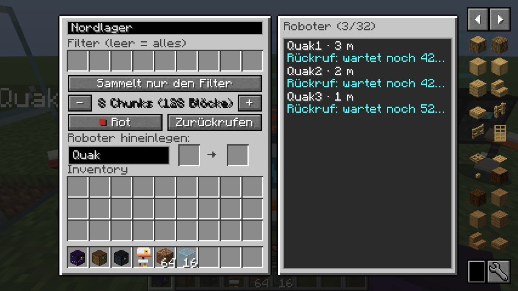

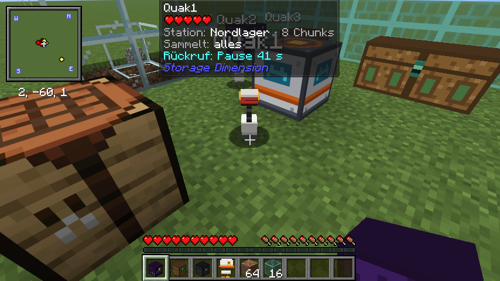

### Wie die Roboter arbeiten

- **Schwarm:** Mehrere Roboter stimmen sich ab. Jeder holt ein anderes Item, es rennen nie alle zum selben.
- **Wege:** Bevor ein Roboter losläuft, plant er den ganzen Weg. Gibt es keinen (eingemauert, hinter einer Roboter-Barriere, über Lava), lässt er das Item eine Minute in Ruhe und nimmt das nächste. Bleibt er unterwegs hängen, gibt er nach 5 Sekunden auf. Neu fallengelassene Items bemerkt er nach spätestens einer halben Sekunde.
- **Klettern:** Er hüpft bis zu zwei Blöcke hoch, auch über Zäune und Mauern, und stellt sich zum Aufheben direkt auf das Item. Kisten erreicht er bis etwa drei Blöcke über dem Boden. Aus Booten und Loren steigt er sofort wieder aus.
- **Zurück zur Station:** Ohne Arbeit läuft er zu seiner Station. Kommt er dabei 3 Minuten lang nicht näher, teleportiert er sich hin.
- **Warten:** An der Station setzt er sich hin und schaut sich fröhlich um, jeder Roboter in seinem eigenen Takt.
- **Fehler:** Erreicht ein Roboter seine Station nicht, fehlt die Station, steht keine Kiste an der Station oder sind alle Kisten voll, setzt er sich hin, schaut auf den Boden, und links und rechts von seinem Namen steht ein rotes 🚫. Den Grund zeigen Jade und die Stationsliste („Fehler: Weg versperrt“, „Fehler: keine Kiste an der Station“, „Fehler: Kisten voll“, „Fehler: Station fehlt“).
- **Wasser:** Roboter tauchen. Unter Wasser laufen sie am Grund entlang und tragen einen Glashelm um den ganzen Kopf. Im Wasser sind sie so schnell wie an Land, ziehen unter Wasser Blasen und an der Oberfläche Spritzer und eine Bugwelle hinter sich her. Items im Wasser schnappen sie, sobald sie in Reichweite ihres Schnabels sind, auch tief am Grund eines Beckens oder treibend an der Oberfläche (z. B. Seetang): Sie springen vom Rand hinein, tauchen hinunter oder schwimmen hinauf und bringen es danach zur Kiste. Ertrinken können sie nicht.
- **Warteplatz:** Zum Warten setzen sie sich nur auf festen, trockenen Boden, nie ins Wasser. Steht die Station am Wasser, klettern sie zum nächsten trockenen Platz daneben.
- **Namensschilder:** Stehen Roboter dicht beieinander, stapeln sich ihre Namen übereinander (bis zu vier Zeilen), statt sich zu überdecken.
- **Regen:** Draußen ohne Dach über sich spannen sie einen kleinen Regenschirm in ihrer Farbe auf.
- **Aufheben:** Schleichen + Rechtsklick mit leerer Hand nimmt einen Roboter wieder auf, samt dem Item im Schnabel.
- Nur Spieler können Robotern schaden. Sie arbeiten nur in geladenen Chunks.

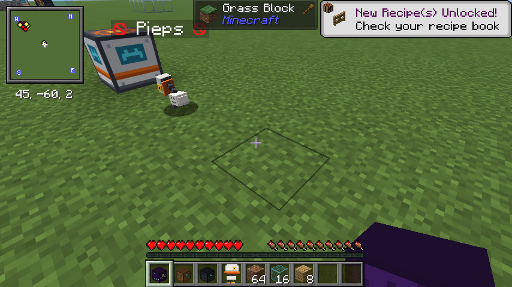

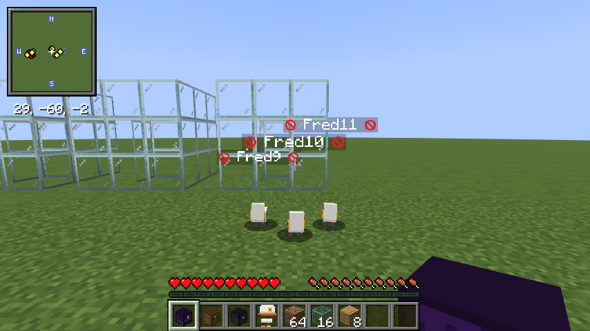

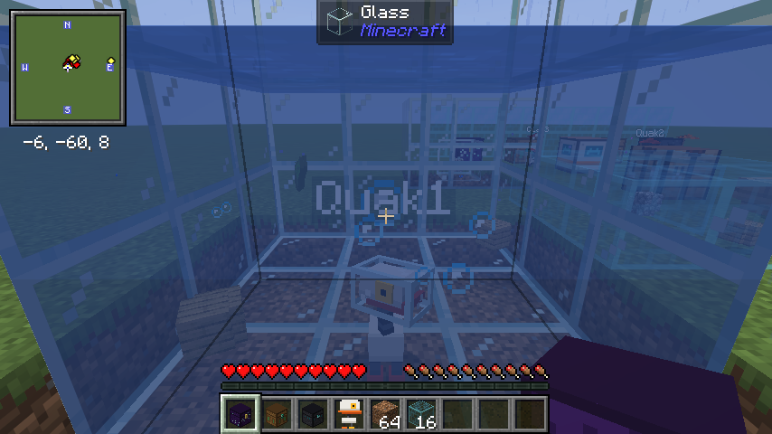

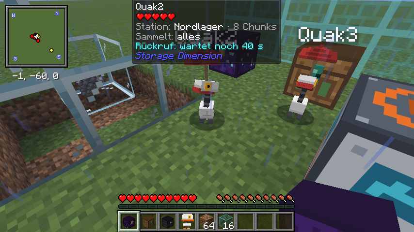

### Jade und Xaero's Minimap

Mit [Jade](https://modrinth.com/mod/jade) zeigt der Blick auf einen Roboter seine Station, Reichweite, Filter und was er gerade tut (oder welchen Fehler er hat). Der Blick auf eine Station zeigt ihren Namen und wie viele Roboter zu ihr gehören. Mit [Xaero's Minimap](https://modrinth.com/mod/xaeros-minimap) erscheinen die Roboter mit ihrem Gesicht auf der Karte.

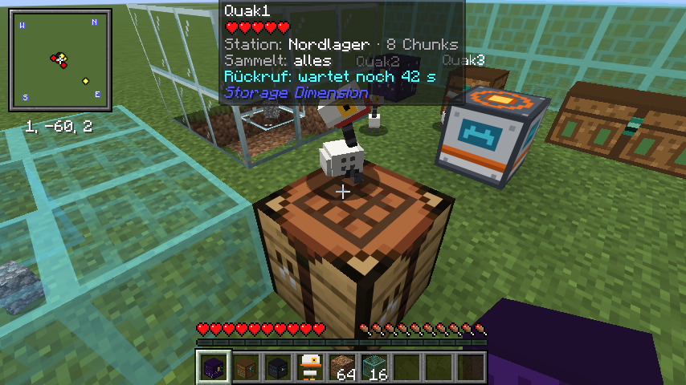

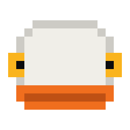

### Roboter-Barriere

Ein durchsichtiger Plasma-Schild. Spieler, Tiere und Items gehen einfach hindurch, Sammelroboter nicht, und sie planen auch keinen Weg hindurch oder darüber. Gut für Türen und Bereiche, aus denen die Roboter nichts holen sollen.

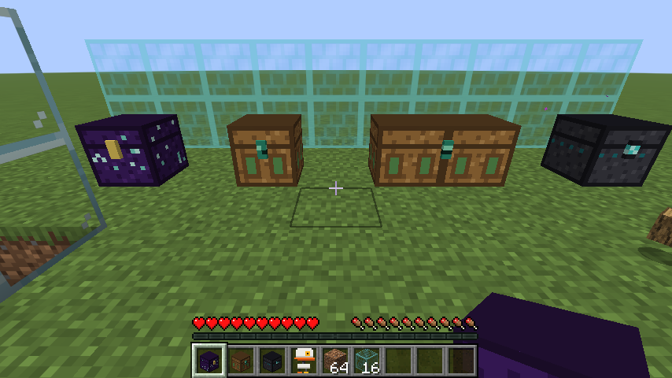

## ME-Rucksack und Traveler's Backpack

Ein Rucksack, der mit dem Speicher verbunden ist und ihn von überall öffnet.

- **Bündel:** ME-Upgrade + Bündel in der Werkbank kombinieren. Rechtsklick öffnet den Speicher.
- **[Traveler's Backpack](https://modrinth.com/mod/travelersbackpack) ohne Add-on:** ME-Upgrade in die Zweithand, den Rucksack in die Haupthand, schleichen und rechtsklicken. Danach öffnet Schleichen + Rechtsklick mit dem Rucksack den ME-Speicher, normaler Rechtsklick weiterhin den Rucksack. Trägst du ihn auf dem Rücken, öffnet `/storage me` den Speicher.

### Traveler's-Backpack-Add-on

Das Add-on `storagedim-tb-0.5.0.jar` fügt ein echtes **ME-Upgrade** für den Upgrade-Slot von Traveler's Backpack hinzu. Es hat immer dieselbe Versionsnummer wie Storage Dimension.

- **Rezept** (formlos): Leeres Upgrade (Traveler's Backpack), Enderauge, 2× Amethystscherbe, Redstoneblock. Mit dem Add-on ergibt auch das normale ME-Upgrade-Rezept (mit Papier) dieses Upgrade. Es passt in den Upgrade-Slot und macht mit einem Bündel auch einen ME-Rucksack.
- **ME-Ansicht:** Upgrade in einen Upgrade-Slot legen. Linksklick auf das ME-Symbol zeigt den ME-Speicher direkt im Rucksack-Fenster an Stelle des Rucksack-Inhalts. Crafting und die anderen Upgrades bleiben daneben. Ein zweiter Linksklick zeigt wieder den Rucksack, Rechtsklick nimmt das Upgrade heraus.
- Die ME-Ansicht ist aufgebaut wie der ME-Speicher: oben eine graue Leiste mit Suchfeld, **J**-Schalter und Sortierung, unten ◀ / ▶, **Einlagern** sowie Seite, Sorten und Gesamtmenge. Die Knöpfe des Rucksacks sind in der ME-Ansicht ausgeblendet. Klicks funktionieren wie im ME-Speicher.
- Der Rucksack muss nicht in der Hand sein: auf dem Rücken tragen und mit der Rucksack-Taste (Standard **B**) öffnen reicht.
- **Crafting aus dem ME-Speicher:** Hat der Rucksack zusätzlich das Crafting-Upgrade, holt der „+“-Knopf von JEI fehlende Zutaten auch aus dem ME-Speicher, genauso wie aus Inventar und Rucksack. „+“ ist nur grün, wenn alle Zutaten zusammen vorhanden sind, sonst markiert JEI die fehlenden rot. Shift + „+“ füllt das Raster für so viele Durchgänge wie möglich (bis zu einem Stapel). Was vorher im Raster lag, kommt zurück ins Inventar oder, wenn das voll ist, in den Speicher.
- Der kleine Schalter neben dem ME-Symbol stellt zwischen *ME als Quelle* (Standard) und *nur Inventar* um.
- **Installation:** `storagedim-tb-0.5.0.jar` und `storage-dimension-0.5.0.jar` auf Server und Clients, dazu Traveler's Backpack, [Forge Config API Port](https://modrinth.com/mod/forge-config-api-port) und Fabric API. JEI wird nur für „+“ und die Rezeptanzeige gebraucht.

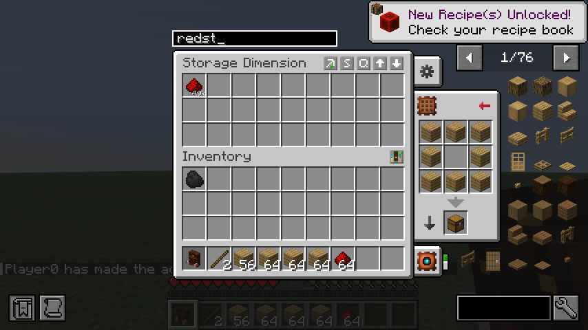

Suche und Sortierung sitzen in der Titelzeile des Fensters, über den Knöpfen des Rucksacks.

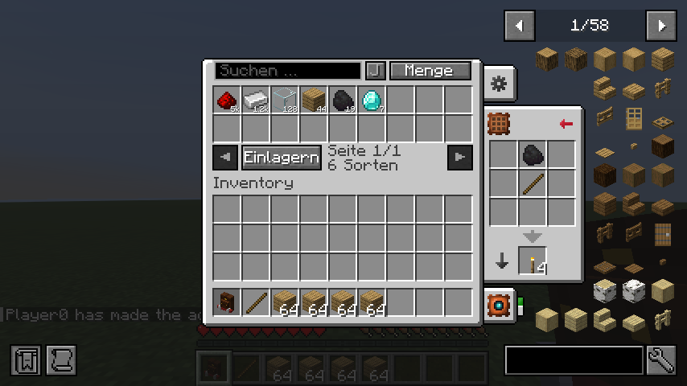

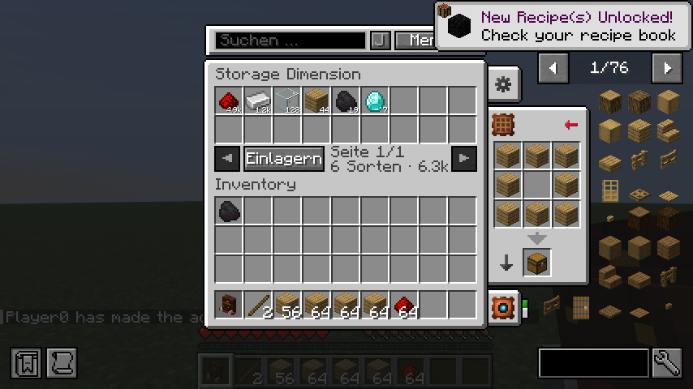

## Rezepte

Alle Rezepte stehen auch in [JEI](https://modrinth.com/mod/jei).

| Item | Zutaten | Rezept |
| --- | --- | --- |
| Dimensionskiste | Amethystscherben, Enderperlen, Kiste | 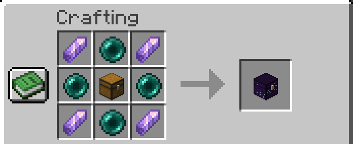 |
| ME-Terminal | Redstone, Amethystscherben, Enderkiste | 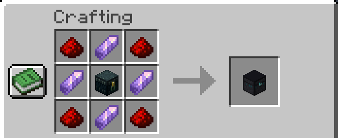 |
| Filterkiste | 8 Rahmen um eine Kiste, unten mittig ein Enderauge | 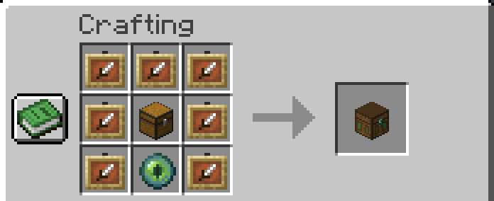 |
| Sammelroboter | Eisenbarren, Kürbis, Redstone, Trichter, Eisennuggets | 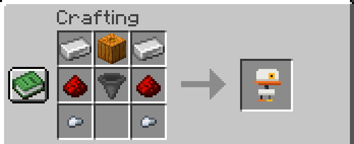 |
| Roboter-Station | Blitzableiter, Eisenbarren, Redstoneblock, Kiste | 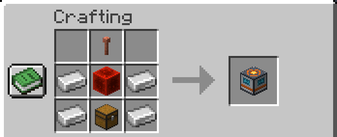 |
| Roboter-Barriere (8 Stück) | 8 Glas um eine Amethystscherbe | 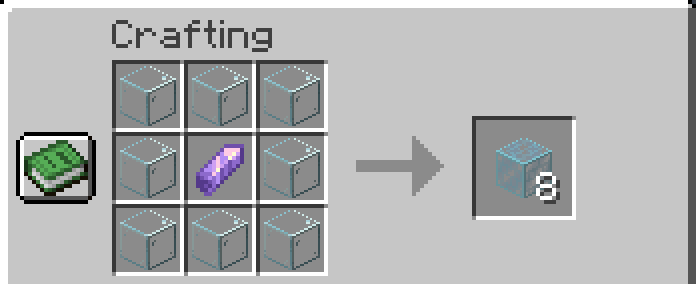 |
| ME-Upgrade | formlos: Enderauge, 2× Amethystscherbe, Redstoneblock, Papier | 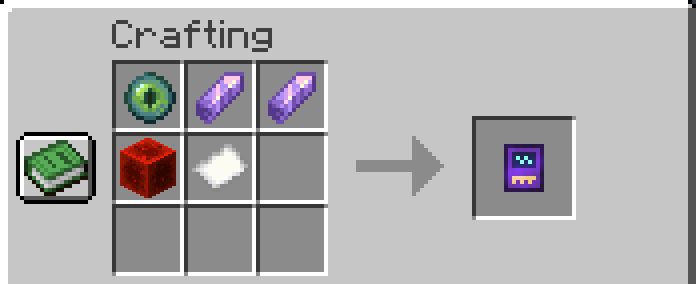 |
| ME-Rucksack | formlos: beliebiges Bündel + ME-Upgrade | 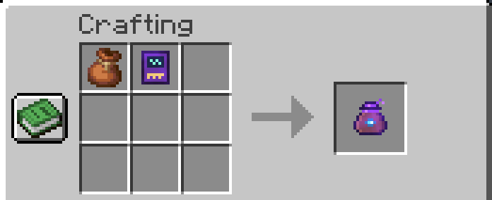 |
| ME-Upgrade (Add-on) | formlos: Leeres Upgrade, Enderauge, 2× Amethystscherbe, Redstoneblock | 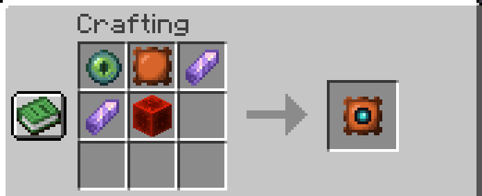 |

## Befehle

| Befehl | Wirkung |
| --- | --- |
| `/storage` | Infos zum eigenen Speicher |
| `/storage raus` | Verlässt den Lagerraum |
| `/storage me` | Öffnet den ME-Speicher, wenn du einen ME-Rucksack trägst oder dabeihast |
| `/storage teilen <spieler>` | Lädt jemanden in deinen Speicher ein (nur ohne gemeinsamen Speicher) |
| `/storage annehmen` | Nimmt eine Einladung an. Dein eigener Speicher bleibt erhalten. |
| `/storage verlassen` | Zurück zum eigenen Speicher |
| `/storage entfernen <spieler>` | Wirft ein Mitglied raus |
| `/storage kiste besitzer <spieler>` | Danach eine eigene Dimensionskiste anklicken, um sie jemandem zu übertragen |
| `/storage give [spieler]` | (OP) Gibt eine Dimensionskiste |
| `/storage give terminal` | (OP) Gibt ein ME-Terminal |
| `/storage give filter` | (OP) Gibt eine Filterkiste |
| `/storage give robot` | (OP) Gibt einen Sammelroboter |
| `/storage give station` | (OP) Gibt eine Roboter-Station |
| `/storage give barrier` | (OP) Gibt 16 Roboter-Barrieren |

## Einstellungen

In `config/storagedim.json`:

| Einstellung | Standard | Wirkung |
| --- | --- | --- |
| `sharedStorage` | `true` | Alle Spieler teilen sich einen Speicher und einen Raum. Mit `false` bekommt jeder seinen eigenen, der sich per `/storage teilen` freigeben lässt (auf dem Server). |
| `jeiSearchSync` | `false` | Schalter **J**: Suche im ME-Speicher mit der JEI-Suchleiste koppeln (beim Spieler, lässt sich im Fenster umschalten). |

## Selbst bauen

Java 25 wird benötigt.

```
cd storage-dimension
./gradlew build
```

Die fertige Datei liegt in `storage-dimension/build/libs/`. GitHub Actions baut bei jedem Push automatisch, macht Test-Screenshots im echten Spiel und legt die Jars auf den Branch `builds`. Ein Release entsteht per Hand unter *Actions → Release → Run workflow*.
